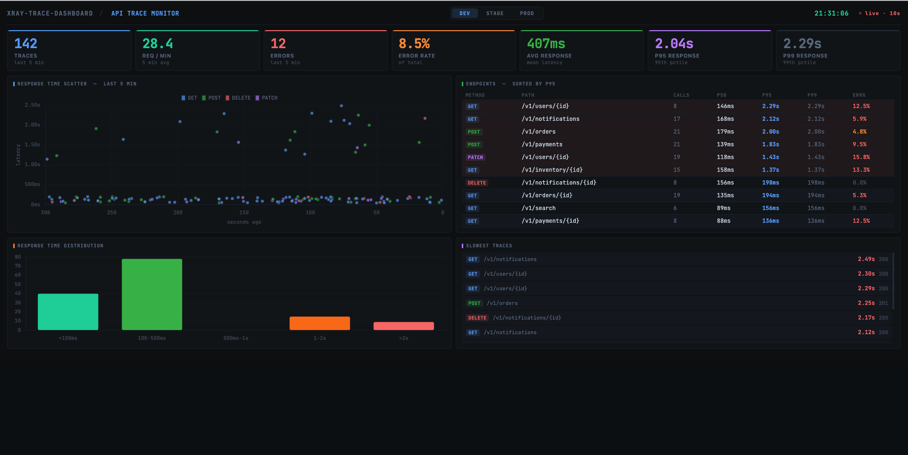
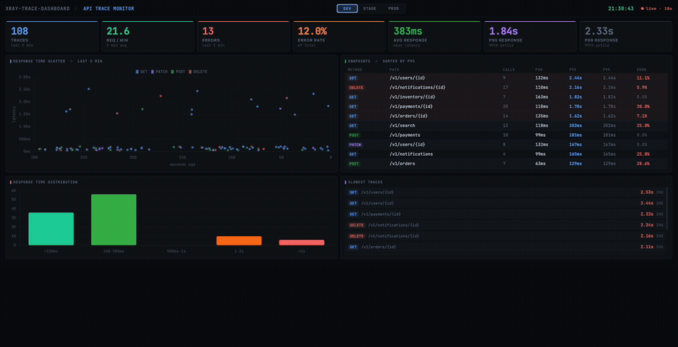

# xray-trace-dashboard

[](https://github.com/manojkken/xray-trace-dashboard/actions/workflows/ci.yml)
[](LICENSE)

A self-contained local dashboard that queries AWS X-Ray in real time and visualises API performance across `dev`, `stage`, and `prod` environments.



<details>
<summary>Demo — switching environments with live updates</summary>



</details>

---

## What it shows

### Summary Cards

| Card | Description |
|---|---|
| **Traces** | Total HTTP requests captured by X-Ray in the last 5 minutes |
| **Req / min** | Average request throughput — `traces ÷ 5` |
| **Errors** | Requests where X-Ray flagged a fault/error or HTTP status ≥ 400 |
| **Error Rate** | `errors ÷ traces × 100%` — percentage of failing requests |
| **Avg Response** | Mean of X-Ray `ResponseTime` values (client-experienced latency) |
| **P95 Response** | 95th percentile latency — 95% of users are faster than this |
| **P99 Response** | 99th percentile latency — tail latency for the slowest 1% |

### Panels

| Panel | Description |
|---|---|
| **Response Time Scatter** | Every trace plotted as `(seconds ago, latency ms)`, coloured by HTTP method. Reveals spikes and method-level patterns at a glance. |
| **Endpoints — sorted by P95** | Aggregated table grouped by `METHOD + normalised path`. UUIDs and numeric IDs are replaced with `{id}` so `/users/123` and `/users/456` collapse into one row. Red background = P95 > 1s. |
| **Response Time Distribution** | Histogram across 5 buckets: `<100ms / 100–500ms / 500ms–1s / 1–2s / >2s`. Green → red colouring shows the health shape of traffic. |
| **Slowest Traces** | Top 10 slowest individual requests in the window. Useful for spotting one-off outliers that wouldn't show in percentiles. |

### Environment Switcher

Traces are separated by hostname pattern:

| Button | Matches |
|---|---|
| `dev` | `*.dev.*` |
| `stage` | `*.stage.*` |
| `prod` | `$PROD_DOMAIN_SUFFIX` (optional exact-match override) or `*.prod.*` |

Switching environment destroys and re-creates the charts with fresh data.

---

## Running locally

### Prerequisites

- Node.js 20+
- AWS credentials for a profile with X-Ray read access (`xray:GetTraceSummaries`)

```bash
npm install
AWS_PROFILE=your-profile-name AWS_REGION=eu-central-1 npm run dev
```

See `.env.example` for the environment variables you can set: `AWS_PROFILE`, `AWS_REGION`, and the optional `PROD_DOMAIN_SUFFIX`.

Open: [http://localhost:3000/traces.html](http://localhost:3000/traces.html)

### With Docker

```bash
docker compose up --build
```

AWS credentials are mounted read-only from `~/.aws` — no secrets in the image.

---

## Project structure

```
xray-trace-dashboard/
├── src/
│   ├── server.ts       # Express app — /api/traces endpoint
│   ├── xray.ts         # GetTraceSummaries with NextToken pagination
│   └── normalize.ts    # URL normalisation, environment detection, percentile
├── frontend/
│   └── traces.html     # Self-contained dashboard (Chart.js 4, no build step)
├── Dockerfile
├── docker-compose.yml
├── package.json
└── tsconfig.json
```

---

## API

### `GET /api/traces?env=dev|stage|prod`

Returns a JSON payload for the requested environment, covering the last 5 minutes.

```jsonc
{
  "timestamp": "2026-03-23T10:42:00.000Z",
  "environment": "prod",
  "windowMinutes": 5,
  "totalTraces": 142,
  "errorCount": 3,
  "globalAvgMs": 87,
  "globalP95Ms": 310,
  "endpoints": [
    {
      "method": "GET",
      "path": "/v1/orders/{id}",
      "service": "orders",
      "count": 41,
      "errorCount": 0,
      "errorRate": 0,
      "p50Ms": 65,
      "p95Ms": 310,
      "p99Ms": 480
    }
  ],
  "recentTraces": [ /* up to 500, sorted by time desc — used for scatter */ ],
  "slowestTraces": [ /* top 10 by duration — used for the slowest list */ ],
  "histogram": [
    { "label": "<100ms",    "count": 89 },
    { "label": "100-500ms", "count": 45 },
    { "label": "500ms-1s",  "count": 6  },
    { "label": "1-2s",      "count": 2  },
    { ">2s":    "label",    "count": 0  }
  ]
}
```

---

## Notes

- X-Ray has ~30s indexing lag — the most recent traces may not appear immediately.
- Traces without HTTP data (SQS consumers, background jobs) are silently skipped.
- URL normalisation replaces UUIDs and 4+ digit numeric segments with `{id}` so noisy per-resource paths collapse into a single endpoint row.
- `ResponseTime` is used instead of `Duration` — it reflects client-experienced latency including network overhead.
